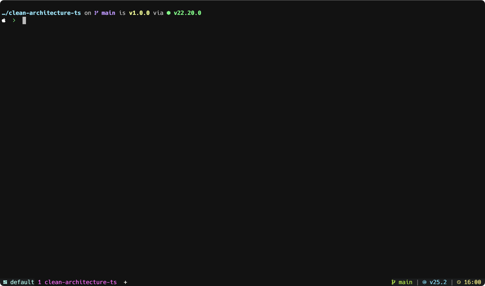

# devbar.wezterm

A developer-focused status bar and tab customizer for WezTerm. Shows git branch, runtime versions (Node, PHP, Python, Go), datetime, SSH status with intelligent config resolution, and more.

## Features

- 🎨 **Clean three-section layout**: workspace/mode | tabs | git/runtimes/time/ssh
- ⚡ **High performance**: intelligent caching (5s git/runtime, 30s direnv, 5min SSH config)
- 🌈 **Theme-aware**: uses WezTerm theme colors by default, with Molokai as fallback
- 🔧 **Developer tools**: shows Node.js, PHP, Python, Go versions when in projects
- 🔄 **Direnv integration**: detects project-specific tool versions via direnv
- 🌐 **SSH-aware**: displays `user@ip` or `user@hostname` based on SSH config resolution
- 🎯 **Nerd Font icons** with ASCII fallbacks
- 📦 **Zero dependencies**: pure Lua + WezTerm
- 🔇 **Clean logs**: only errors shown in Debug Overlay, warnings for debugging

## Visual Layout

```
┌───────────────────────────────────────────────────────────────────────────────────────┐
│ 🪟 default | COPY │ 1 project │ 2 󰣀 admin@127.0.0.1 │ main | 󰎙 v20.8 | 11:45 | server │
└───────────────────────────────────────────────────────────────────────────────────────┘
```

**Left section**: Workspace name + active mode (COPY/SEARCH when active)  
**Center**: Tabs with number + directory/SSH info + zoom indicator  
**Right**: Git branch | Runtime versions | Time (24h) | SSH hostname

## 📷



## Prerequisites

- **WezTerm** (recent version with plugin support, 20230712+)
- **Recommended**: Nerd Font installed (Hack Nerd Font, FiraCode Nerd Font, or JetBrainsMono Nerd Font)
- **Optional**: git, node, php, python, go (for their respective segments)
- **Optional**: direnv (for project-specific tool version detection)

## Installation

### Quick Start

Add to `~/.wezterm.lua`:

```lua
local wezterm = require('wezterm')
local config = wezterm.config_builder()

-- Existing configuration...
config.color_scheme = 'Monokai Pro'

-- Load devbar (must be AFTER color_scheme is set)
local devbar = wezterm.plugin.require('https://github.com/carlos-andres/devbar.wezterm')
devbar.apply_to_config(config)

return config
```

**Important**: `devbar.apply_to_config()` must be called **after** setting `color_scheme` so it can inherit theme colors.

### Local Development

For local testing during development:

```lua
local devbar = wezterm.plugin.require('file:///absolute/path/to/devbar.wezterm')
devbar.apply_to_config(config)
```

## Configuration

### Default Configuration

```lua
local devbar = wezterm.plugin.require('https://github.com/carlos-andres/devbar.wezterm')

devbar.apply_to_config(config, {
  position = 'bottom',          -- "top" or "bottom"
  use_ascii_icons = false,      -- Set true to force ASCII fallback icons

  divider = ' | ',              -- Segment separator in status bar

  truncate = {
    branch = 20,                -- Git branch max length
    cwd = 30,                   -- Directory name max length
    tab = 32,                   -- Tab title max width
  },

  cache_ttl = 5,                -- Cache duration in seconds (git, runtimes)
  ssh_cache_ttl = 60,           -- SSH config cache duration in seconds

  segments = {
    workspace = { enabled = true },
    mode = { enabled = true },  -- Show COPY/SEARCH/etc when active
    zoom = { enabled = true },  -- Show zoom indicator on tabs
    git = { enabled = true },
    runtimes = { enabled = true },
    datetime = {
      enabled = true,
      format = '%H:%M',         -- 24-hour format (strftime)
    },
    ssh = { enabled = true },
  },

  colors = nil,                 -- nil = auto-detect, or provide custom palette

  padding = {
    left = 1,
    right = 1,
  },
})
```

### Customization Examples

#### Minimal configuration (only tabs and time)

```lua
devbar.apply_to_config(config, {
  segments = {
    workspace = { enabled = false },
    mode = { enabled = false },
    git = { enabled = false },
    runtimes = { enabled = false },
    datetime = { enabled = true },
    ssh = { enabled = true },
  },
})
```

#### Developer-focused (all segments enabled)

```lua
devbar.apply_to_config(config, {
  segments = {
    git = { enabled = true },
    runtimes = { enabled = true },
    datetime = { enabled = true, format = '%H:%M:%S' }, -- include seconds
  },
  cache_ttl = 3, -- Faster updates (3 seconds)
})
```

#### ASCII icons mode (no Nerd Font required)

```lua
devbar.apply_to_config(config, {
  use_ascii_icons = true,
})
```

#### Custom colors

```lua
devbar.apply_to_config(config, {
  colors = {
    git = '#A6E22E',        -- green
    runtime = '#66D9EF',    -- blue
    datetime = '#E6DB74',   -- yellow
    ssh = '#F92672',        -- red
  },
})
```

## How It Works

### Git Integration

- Detects git branch using `git branch --show-current`
- Only shows when in a git repository
- Handles detached HEAD (shows `HEAD@<short-sha>`)
- Cached for 5 seconds (configurable)

### Runtime Detection

Detects runtimes **only in git repositories** and when tools are installed:

| Runtime | Marker File(s) | Command | Display |
|---------|----------------|---------|---------|
| **Node.js** | `package.json` | `node --version` | 󰎙 v20.8 |
| **PHP** | `composer.json` | `php -v` | 󰌟 v8.3 |
| **Python** | `requirements.txt`, `pyproject.toml`, `setup.py`, `Pipfile` | `python3 --version` |  v3.11 |
| **Go** | `go.mod` | `go version` |  v1.21 |

### Direnv Integration

When using [direnv](https://direnv.net/) for project-specific environments:

- **Automatic detection**: Checks for `.envrc` files in project directories
- **Tool version resolution**: Detects direnv-managed Node, PHP, Python versions
- **Performance optimized**: Caches direnv exports for 30 seconds
- **Graceful fallback**: Works without direnv installed

**Example**: Projects with `.envrc` containing `use node 18.20.0` will display the direnv-managed version instead of the global installation.

### SSH Detection & Config Resolution

Smart SSH tab display that shows the **actual** connection details:

- **Resolves SSH aliases**: Parses `~/.ssh/config` using `ssh -G`
- **Shows real user@ip**: `admin@192.168.1.100` instead of `user@server-prod`
- **Caches SSH config**: 5-minute cache to avoid repeated lookups
- **Right corner hostname**: Shows short alias name (`server-prod`) in status bar

**Example**:
```ssh-config
# ~/.ssh/config
Host server-prod
  User admin
  HostName 192.168.1.100
```

When connecting via `ssh server-prod`:
- **Tab shows**: `2 󰣀 admin@192.168.1.100`
- **Status bar shows**: `server-prod` (short name)

### Performance

- **Cached operations**: 
  - Git branch, runtime detection: 5s TTL (configurable)
  - Direnv exports: 30s TTL
  - SSH config resolution: 5min TTL
  - Direnv installation check: 24h TTL
- **Fast paths**: CWD extraction, icon lookups, tab formatting (<5ms)
- **Total overhead**: ~20ms cached, ~100-220ms on cache miss (first load)
- **No perceptible lag**: WezTerm's `update-status` fires frequently but we return cached values

## Troubleshooting

### No git branch showing?

- Ensure git is installed: `which git`
- Verify working in a git repository: `git status`
- Check WezTerm Debug Overlay for warnings: `Cmd+Shift+L` (macOS) or `Ctrl+Shift+L` (Linux)

### No runtime versions?

- Ensure tools are in PATH: `which node`, `which php`, etc.
- **Only shows in git repositories** (by design)
- Check project markers exist (`package.json`, `composer.json`, etc.)
- Check WezTerm Debug Overlay for warnings: `Cmd+Shift+L`

### Tab directory not updating when you cd?

**Root Cause**: WezTerm needs **shell integration** (OSC 7 escape sequences) to detect directory changes immediately. Without it, directory updates are delayed or fail.

**Solution**: Add WezTerm shell integration to your shell configuration file:

#### 🐚 Bash (~/.bashrc or ~/.bash_profile)

```bash
# WezTerm shell integration
if [[ -n "$WEZTERM_PANE" ]]; then
  # Download integration script (one-time)
  WEZTERM_SHELL_INTEGRATION="$HOME/.config/wezterm/shell-integration.sh"
  if [[ ! -f "$WEZTERM_SHELL_INTEGRATION" ]]; then
    mkdir -p "$(dirname "$WEZTERM_SHELL_INTEGRATION")"
    curl -fsSL https://raw.githubusercontent.com/wez/wezterm/main/assets/shell-integration/wezterm.sh \
      -o "$WEZTERM_SHELL_INTEGRATION"
  fi
  source "$WEZTERM_SHELL_INTEGRATION"
fi
```

#### 🦓 Zsh (~/.zshrc)

```zsh
# WezTerm shell integration
if [[ -n "$WEZTERM_PANE" ]]; then
  # Download integration script (one-time)
  WEZTERM_SHELL_INTEGRATION="$HOME/.config/wezterm/shell-integration.sh"
  if [[ ! -f "$WEZTERM_SHELL_INTEGRATION" ]]; then
    mkdir -p "$(dirname "$WEZTERM_SHELL_INTEGRATION")"
    curl -fsSL https://raw.githubusercontent.com/wez/wezterm/main/assets/shell-integration/wezterm.sh \
      -o "$WEZTERM_SHELL_INTEGRATION"
  fi
  source "$WEZTERM_SHELL_INTEGRATION"
fi
```

#### 🐠 Fish (~/.config/fish/config.fish)

```fish
# WezTerm shell integration
if set -q WEZTERM_PANE
  function __wezterm_osc7 --description "Inform WezTerm of current directory"
    printf "\033]7;file://%s%s\033\\" (hostname) (pwd)
  end
  
  # Emit OSC 7 before each prompt
  function __wezterm_prompt --on-event fish_prompt
    __wezterm_osc7
  end
end
```

**Verify Installation**:

```bash
# 1. Restart your shell or source the config
source ~/.bashrc  # or ~/.zshrc

# 2. Check if WEZTERM_PANE is set
echo $WEZTERM_PANE  # Should print a pane ID like "1"

# 3. Test directory change
cd /tmp
# Tab should update immediately to show "tmp"
```

**For SSH Sessions**: Install shell integration on the **remote server**, not just locally.

**Platform-Specific Notes**:
- **macOS**: Without shell integration, you may hit [WezTerm bug #4811](https://github.com/wez/wezterm/issues/4811) with stale CWD
- **Linux**: Process fallback is more reliable but still slower than OSC 7
- **Performance**: Shell integration adds <1ms overhead per prompt

### SSH tab shows `user@alias` instead of `user@ip`?

**Cause**: SSH config resolution failed or plugin cache is stale.

**Solutions**:
1. **Clear plugin cache**:
   ```bash
   rm -rf "$HOME/Library/Application Support/wezterm/plugins"
   ```
   Then reload WezTerm: `Cmd+Shift+R`

2. **Verify SSH config**:
   ```bash
   ssh -G server-prod | grep -E "^(hostname|user)"
   ```
   Should output:
   ```
   user admin
   hostname 192.168.1.100
   ```

3. **Check Debug Overlay** (`Cmd+Shift+L`) for warnings like:
   ```
   WARN devbar.util: failed to resolve SSH config for: server-prod
   ```

### SSH TERM warning in Debug Overlay?

**Warning shown**:
```
WARN wezterm_ssh::pty > ssh: setenv TERM=xterm-256color failed: RequestDenied
```

**Cause**: The SSH server doesn't accept the `TERM` environment variable.

**This is NOT a plugin issue** - it's a WezTerm SSH connection warning.

**Solutions**:

1. **Client-side fix** (recommended, already applied):
   
   Add to `~/.ssh/config` global settings:
   ```ssh-config
   Host *
       SendEnv TERM
   ```

2. **Server-side fix** (requires sudo access):
   
   Edit `/etc/ssh/sshd_config` on the server:
   ```bash
   # Add this line
   AcceptEnv LANG LC_* TERM
   ```
   
   Restart SSH:
   ```bash
   sudo systemctl restart sshd
   ```

3. **Ignore it**: The warning is harmless - SSH connections work normally.

### Icons show as boxes (□) or missing glyphs?

- **Install a Nerd Font**: https://www.nerdfonts.com/
  - Recommended: Hack Nerd Font, FiraCode Nerd Font, JetBrainsMono Nerd Font
- Configure WezTerm to use the font:
  ```lua
  config.font = wezterm.font('Hack Nerd Font Mono')
  ```
- Alternatively, enable ASCII fallback mode:
  ```lua
  devbar.apply_to_config(config, { use_ascii_icons = true })
  ```

### Bar not appearing?

- Ensure `devbar.apply_to_config()` is called **after** setting `color_scheme`
- Check WezTerm version supports plugins (20230712 or newer)
- Check WezTerm Debug Overlay for errors: `Cmd+Shift+L`

### Colors look wrong?

- devbar inherits colors from the active theme
- If theme colors aren't detected, it falls back to Molokai palette
- Override with custom colors (see [Configuration](#configuration))

### Performance issues?

- Increase cache TTL:
  ```lua
  devbar.apply_to_config(config, { cache_ttl = 10 })
  ```
- Disable expensive segments:
  ```lua
  devbar.apply_to_config(config, {
    segments = {
      git = { enabled = false },
      runtimes = { enabled = false },
    },
  })
  ```

### Debug Overlay shows too many logs?

The plugin is designed to be **quiet**:
- ❌ No INFO logs (removed for clean overlay)
- ⚠️ WARN logs only for real issues (SSH config resolution, command failures, etc.)
- ❌ ERROR logs only for critical failures

For excessive warnings, please [open an issue](https://github.com/carlos-andres/devbar.wezterm/issues).

## Font Recommendations

devbar works best with **Nerd Fonts**. Install one of these:

1. **Hack Nerd Font** (recommended)
   ```lua
   config.font = wezterm.font('Hack Nerd Font Mono')
   ```

2. **FiraCode Nerd Font**
   ```lua
   config.font = wezterm.font('FiraCode Nerd Font Mono')
   ```

3. **JetBrainsMono Nerd Font**
   ```lua
   config.font = wezterm.font('JetBrainsMono Nerd Font Mono')
   ```

Download from: https://www.nerdfonts.com/

## Platform Support

- ✅ **macOS** (tested on M2 Max, macOS 15.7.1)
- ✅ **Linux** (tested)
- ⚠️ **Windows** (untested, should work with WSL)

Uses `/bin/sh -lc` for shell commands, ensuring compatibility across Unix-like systems without assuming Homebrew paths.

## Advanced Features

### Reload Plugin After Changes

When developing or testing changes:

```bash
# Option 1: Use the provided script
cd /path/to/devbar.wezterm
./RELOAD.sh

# Option 2: Manual cache clear
rm -rf "$HOME/Library/Application Support/wezterm/plugins"

# Then reload WezTerm
# Press Cmd+Shift+R (macOS) or Ctrl+Shift+R (Linux)
```


### Debug Overlay

Open the Debug Overlay to see warnings and errors:
- **macOS**: `Cmd+Shift+L`
- **Linux**: `Ctrl+Shift+L`

The overlay displays:
- Plugin loading status
- SSH config resolution results
- Runtime detection failures
- Command execution errors

## Project Structure

```
devbar.wezterm/
├── LICENSE                 # MIT License
├── README.md              # This file
├── RELOAD.sh              # Cache clearing utility
├── .editorconfig          # Editor configuration
├── .stylua.toml           # Lua formatter config
└── plugin/
    ├── init.lua           # Main entry point
    └── devbar/
        ├── cache.lua      # TTL-based caching
        ├── config.lua     # Configuration management
        ├── direnv_helper.lua # Direnv integration
        ├── git.lua        # Git branch detection
        ├── icons.lua      # Nerd Font + ASCII icons
        ├── runtime.lua    # Runtime version detection
        ├── tabs.lua       # Tab formatting (SSH-aware)
        ├── theme.lua      # Color palette management
        └── util.lua       # Utilities + SSH config parser
```

## Contributing

Contributions welcome! Please feel free to submit issues or pull requests.

### Development Setup

1. Clone the repository:
   ```bash
   git clone https://github.com/carlos-andres/devbar.wezterm.git
   cd devbar.wezterm
   ```

2. Use local file path in `wezterm.lua`:
   ```lua
   local devbar = wezterm.plugin.require('file:///path/to/devbar.wezterm')
   ```

3. Make changes and test

4. Format code before committing:
   ```bash
   stylua plugin/
   ```

5. Submit a pull request

## License

MIT License - see [LICENSE](LICENSE) file for details.

## Acknowledgments

- Inspired by [rose-pine/tmux](https://github.com/rose-pine/tmux)
- Reference implementations: [bar.wezterm](https://github.com/adriankarlen/bar.wezterm), [tabline.wez](https://github.com/michaelbrusegard/tabline.wez)
- Built for [WezTerm](https://wezfurlong.org/wezterm/)
- Thanks to the WezTerm community for excellent plugin support


---

Made with ❤️ for developers who live in the terminal. 
